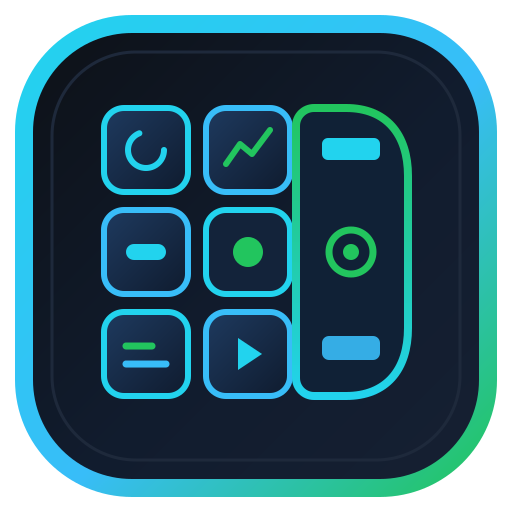

<p align="center">
  
</p>

<h1 align="center">DeckStudio</h1>

<p align="center">
  <strong>Alternativa nativa, ultraleve e 100% gratuita (Licença MIT) para controladores Stream Dock no Windows.</strong><br/>
  Substitui softwares baseados em WebEngine/Electron por um daemon nativo em <b>Rust</b> na bandeja + editor visual em <b>Tauri v2 / React</b> com <b>0 MB de WebView2 ao fechar</b>.
</p>

---

## Por que usar o DeckStudio?

- **100% Gratuito e Open Source ([MIT License](LICENSE)):** uso livre, sem telemetria fechada, assinatura ou bloatware.
- **Zero perda de pacotes em jogos e streaming:** projetado para eliminar gargalos de DPC/rede causados por processos `QtWebEngineProcess.exe` (~252 MB) no driver Realtek — **0% de perda UDP em 300 Mbps (`iperf3`) e `delta = 0` descartes na NIC**.
- **Consumo mínimo 24/7:** `deck-engine.exe` consome **`~18,5–20,3 MB` WorkingSet (`5,3–7,15 MB` memória privada)** e `0%` CPU idle; o editor `deck-studio.exe` encerra 100% dos processos `msedgewebview2` ao fechar.
- **4 Fontes de Telemetria com Guias em Português e Fallback Automático:**
  1. **AIDA64 Shared Memory** (`AIDA64_SensorValues`) + vigia automática de 45s.
  2. **LibreHardwareMonitor** (`http://127.0.0.1:8085/data.json`, gratuito/open-source, backoff de 30s quando offline).
  3. **HWiNFO64 Shared Memory** (`Global\HWiNFO_SENS_SM2`).
  4. **Windows Nativo + NVIDIA NVML (`nvml.dll`)** sem precisar instalar apps externos (com standby automático do NVML quando outra fonte prioritária já lê GPU).
- **Automação completa:** OBS WebSocket v5 (gravação, pausa, mudo, troca de cenas, status ao vivo), clima Open-Meteo, Smart Profiles por `SetWinEventHook` (`0%` polling), Hotkeys Win32, Soundboard, Webhooks e Multi-Actions.

---

## Compatibilidade de Hardware

> Consulte o guia detalhado e o protocolo seguro em **[docs/COMPATIBILITY.md](docs/COMPATIBILITY.md)**.

- **Testado e Verificado em bancada:** **AJAZZ AKP153E** (`VID 0x0300 : PID 0x1010`, protocolo HID 512 bytes, grade 5×3 + faixa lateral 3×1).
- **Modelos Similares (Família OEM Mirabox — Candidatos em análise):**
  - **AJAZZ AKP153** (`5548:6674`) e revisões **AKP153E / AKP153R** (`0300:1020`, `3010`, `3011`)
  - **Mirabox StreamDock HSV293S** (`5548:6670`) e **HSV293SV3 / 293V3** (`6603:1014`, `1005`)
  - Rebadges OEM Mirabox de 15 teclas (**Mars Gaming**, **Soomfon**, **Womier**, **RiseMode**, **Monstargear**)
- **Roadmap Futuro:** modelos com encoders rotativos (**AJAZZ AKP03**, **VSDinside StreamDock N3 / N4**).

---

## Arquitetura, Design System & Documentação

- **Manual Completo do App (Funcionalidades, Ações, Sensores, Clima & Segurança):** [docs/MANUAL.md](docs/MANUAL.md)
- **Design System (`tokens.css` + componentes React):** [docs/DESIGN_SYSTEM.md](docs/DESIGN_SYSTEM.md)
- **Compatibilidade de Hardware & Protocolo HID:** [docs/COMPATIBILITY.md](docs/COMPATIBILITY.md)
- **Histórico & Benchmarks de Evolução:** [docs/EVOLUTION.md](docs/EVOLUTION.md) & [CHANGELOG.md](CHANGELOG.md)
- **Análise de Impacto (Todos os 10 Diagramas Archify):** [docs/archify/README.md](docs/archify/README.md)

## Compilação, Testes e Release

```powershell
# Rodar suíte completa (25 testes Rust: deck-core + deck-engine)
Set-Location deckstudio
cargo clippy --workspace --all-targets -- -D warnings
cargo test --workspace

# Gerar Release versionado (compila, testa, gera instalador NSIS + SHA256SUMS + GitHub Release)
Set-Location ..
.\scripts\release.ps1 -Version "0.4.10" -Publish
```

## Rollback para o Software Oficial
Se precisar restaurar a inicialização original, importe [rollback/restore_stream_dock_ajazz.reg](rollback/restore_stream_dock_ajazz.reg). O protótipo original em Python permanece arquivado em [legacy_monitor/](legacy_monitor/) para referência técnica.
